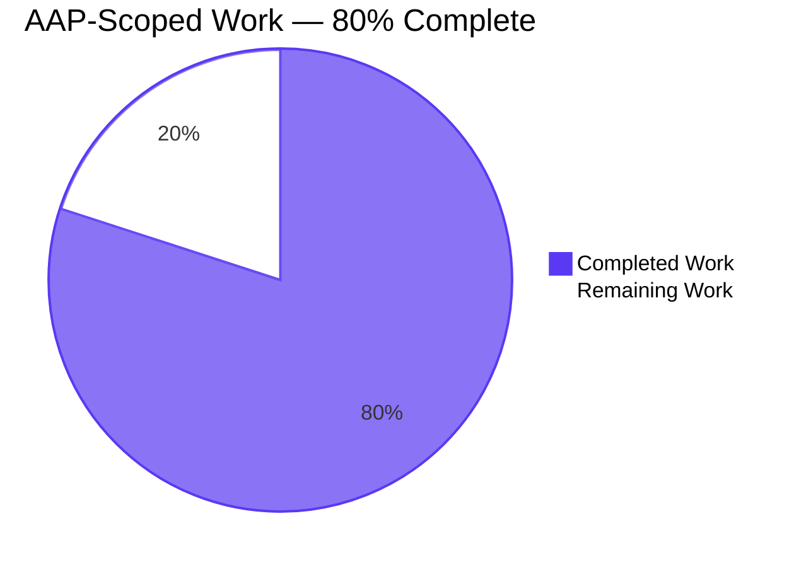
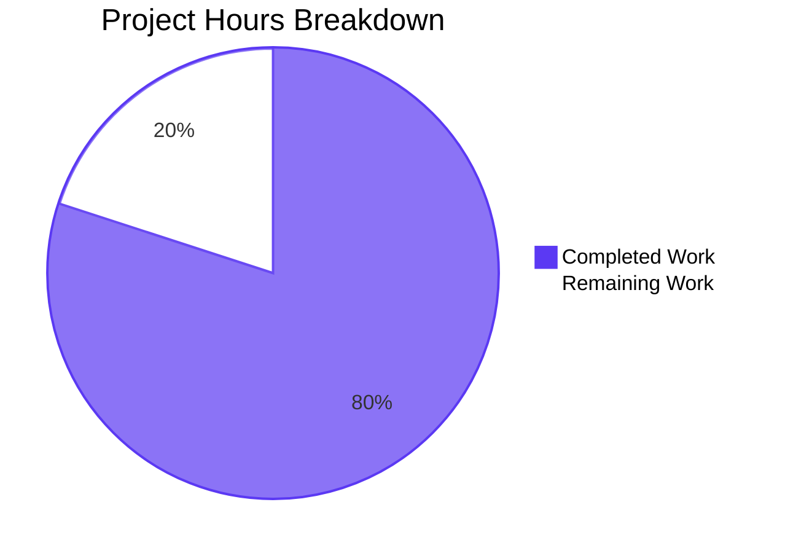
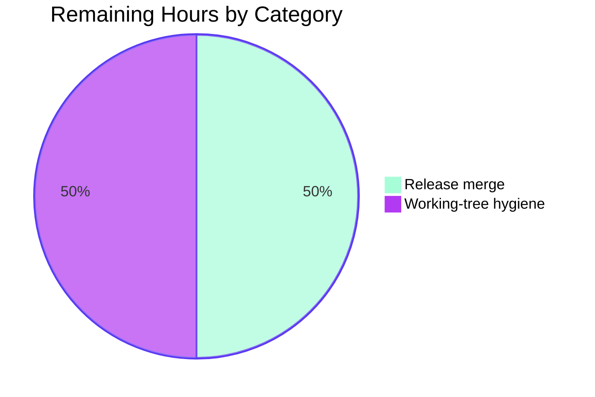

# 1. Executive Summary

## 1.1 Project Overview

This project adds one static text artefact: `hello_world.txt` at the repository root, holding five lines of `Welcome to Blitzy` — 17 characters each, 90 bytes of ASCII, LF-terminated, mode 0644 — and changes nothing else. The repository already holds a 14-line Node.js HTTP listener (`server.js`), a one-line `README.md` and an Apache-2.0 `LICENSE`, all three left byte-identical. The file is standalone data with no consumer: nothing loads, serves or references it. Its audience is anyone needing the greeting as plain text; the scope is content authoring with no runtime, dependency or build surface.

## 1.2 Completion Status

**80% complete — 4.0 hours delivered out of 5.0 hours of AAP-scoped work.**



| Metric | Hours | Basis |
|---|---|---|
| Total Hours | 5.0 | Completed 4.0 h + Remaining 1.0 h |
| Completed Hours (Baseline: Human with agentic-assist) | 4.0 | All 31 AAP requirements delivered and verified |
| Remaining Hours | 1.0 | Path-to-production work only: release merge and working-tree hygiene |
| Percent Complete | 80% | 4.0 ÷ 5.0 × 100 |

## 1.3 Key Accomplishments

- ✅ `hello_world.txt` at the repository root with exactly five lines of `Welcome to Blitzy`, 17 characters each, byte-identical to the request (sha256 `33b05702…cedc35`).
- ✅ Byte contract met on disk, in the index and in the commit: LF endings, one final newline, no BOM, ASCII, 90 bytes, mode 0644.
- ✅ One additive commit (`8d7ca98`): one path added, zero deletions, clean status afterwards.
- ✅ `server.js`, `README.md` and `LICENSE` byte-identical to their previous commits.
- ✅ No test, fixture, generator, configuration, documentation or manifest artefact added.
- ✅ No integration point: nothing reads, serves or references the file.
- ✅ 32 acceptance checks executed across content, bytes, tree, provenance and runtime — 32 passed, 0 failed.
- ✅ The untouched listener still parses and answers `200 text/plain` with its 34-byte greeting at runtime.

## 1.4 Critical Unresolved Issues

**No requested deliverable is outstanding — 1 of 1 delivered. Three follow-up items stay open; none blocks the delivered capability.**

| Issue | Impact | Owner | ETA |
|---|---|---|---|
| The branch carrying `hello_world.txt` is not merged into the default branch | The file is not yet present for anyone consuming the default branch | Repository owner | Next merge window |
| Two empty untracked directories (`blitzy/screenshots/`, `blitzy/screen_recordings/`) remain in the working tree | A later `git add -A` after content lands there would stage paths this change does not allow | Repository owner | Before the next commit |
| No automated guard protects the delivered bytes — accepted by design, since the change may add no test artefact | A future edit that corrupts the bytes fails nothing; correctness is re-established only by re-running the byte probes | Repository owner | None scheduled; verify at each release |

## 1.5 Access Issues

No access issues identified. Nothing needs a credential, service account, API key or third-party access: the file is inert data, `server.js` uses only Node's built-in `http`, and no environment variable is read. Publishing the commit needs only the repository write access already in use.

## 1.6 Recommended Next Steps

1. **[High]** Merge the branch carrying `hello_world.txt` into the default branch.
2. **[Medium]** Remove the two empty untracked directories before the next `git add -A`.
3. **[Medium]** Re-run the byte probes before merging: `wc -l` 5, `wc -c` 90, `grep -vc` 0, `stat -c '%a'` 644.
4. **[Low]** If a permanent byte guard is wanted, add it as a separate change.
5. **[Low]** Leave `server.js` and `README.md` untouched.

# 2. Project Hours Breakdown

## 2.1 Completed Work Detail

| Component | Hours | Description |
|---|---|---|
| `hello_world.txt` content authoring | 0.5 | The file created at the repository root with five LF-terminated lines of `Welcome to Blitzy`, committed as the only added path (`8d7ca98`, 5 insertions, 0 deletions). Traces to AAP §0.1.1 R1–R3 and §0.5.1 (one CREATE at the root). |
| Byte contract production | 0.5 | The decided byte properties produced and confirmed on disk, in the index and in the commit: LF endings, exactly one final newline, UTF-8 without BOM, ASCII, 90 bytes, mode 0644. Traces to AAP §0.5.2's byte-property table. |
| Acceptance and byte-level verification | 2.0 | The acceptance set executed and extended to 32 checks: presence, line count, byte count, deviation count, byte dump, terminator, BOM, CR, blank and whitespace probes, encoding, mode, reference byte-identity (`cmp` plus SHA-256), and tampering probes for CRLF, truncation, a sixth line, a BOM and mode drift. Traces to AAP §0.6's acceptance commands and §0.1.3's verbatim content. |
| Tree preservation, provenance and integration proof | 1.0 | Sibling blob identity and the single-path commit delta; confirmation that the path was free before the write, so the conflict rule was satisfied; reference sweeps proving no consumer and no wiring; sanctioned-absence probes for the five forbidden artefact classes; absence of rules and attachments confirmed. Traces to AAP §0.1.1 R4–R6, §0.2.2, §0.2.3, §0.4, §0.7.1/§0.7.2, §0.8 and §0.9. |
| **Total** | **4.0** | Equals Completed Hours in Section 1.2 |

## 2.2 Remaining Work Detail

| Category | Hours | Priority |
|---|---|---|
| Path-to-production — release merge: bring the branch carrying `hello_world.txt` into the default branch, and confirm the path is present afterwards (neither `origin/main` nor `origin/2610_01` carries the file today) | 0.5 | Medium |
| Path-to-production — working-tree hygiene: remove the two empty untracked directories so a later `git add -A` cannot stage paths outside this change | 0.5 | Medium |
| **Total** | **1.0** | Equals Remaining Hours in Sections 1.2 and 7 |

No AAP requirement appears here: all 31 are delivered and verified. The remaining hours are path-to-production steps only.

## 2.3 Hours Estimation Basis

Completed hours were measured against what the delivered artefact required, not against elapsed effort: one content-authoring unit (0.5 h), one byte-contract unit (0.5 h), verification proportional to an artefact whose only provable property is its bytes (2.0 h for 32 executed checks), and tree preservation plus provenance proof (1.0 h for the full requirement set beyond the file itself). Remaining hours are two discrete release steps at the half-hour floor each.

Completion follows the AAP-scoped formula: **Completed ÷ (Completed + Remaining) × 100 = 4.0 ÷ 5.0 × 100 = 80%**. The figure sits below 100% solely because path-to-production work remains outstanding; it is not reduced by any incomplete requirement. Confidence is high for both figures: the deliverable is one file with fully enumerated acceptance criteria, and the two remaining steps have no unknowns.

# 3. Test Results

The repository ships no automated test suite: 0 test files, no runner, no package manifest and no build step, and the change's own rules forbid adding a test, fixture or validator. The executed evidence is therefore the acceptance set below, run against the delivered commit. **32 checks executed, 32 passed, 0 failed.**

| Area / Category | Framework | Tests | Passed | Failed | Coverage | What This Proves |
|---|---|---|---|---|---|---|
| File presence and line content | Shell acceptance set (`test`, `wc`, `grep`, `awk`, `od`, `cmp`) | 9 | 9 | 0 | Not instrumented — no coverage tooling exists in this repository | Every line is byte-exactly `Welcome to Blitzy`: five of them, 17 characters each, none deviating, byte-identical to a reference built from the requested content |
| Byte contract — terminators, encoding, whitespace, size, mode | Shell byte inspection (`od`, `head -c`, `tail -c`, `grep -c`, `stat`, `file`) | 8 | 8 | 0 | Not instrumented | The file ends with exactly one LF, carries no CR, no BOM, no blank or padded line, is 90 bytes of ASCII, and is mode 0644 |
| Commit and tree integrity | Git (`show`, `status`, `ls-tree`, `diff`, `ls-files`) | 7 | 7 | 0 | Not instrumented | The commit adds one path and no other, the three pre-existing files are byte-identical, and the tree holds no test, configuration or manifest artefact |
| No integration point | `git grep` across the tree | 2 | 2 | 0 | Not instrumented | Nothing loads, serves or references the file, and the HTTP listener never reads a file |
| Authoring provenance and conflict rule | Git history, numstat, `cat-file` | 3 | 3 | 0 | Not instrumented | The path was written once in one commit with 5 insertions and 0 deletions and was free at the parent commit; no generator artefact exists in the tree or the history |
| Pre-existing HTTP entry point | Node runtime plus `curl` | 3 | 3 | 0 | Not instrumented | `server.js` still parses and answers `200 text/plain` with its greeting, and returns that same greeting for the deliverable's path, confirming no route serves it |
| **Total** | — | **32** | **32** | **0** | — | — |

Deliberate tampering probes were run inside the byte-contract category to establish that each failure mode is detectable: CRLF injection, a truncated final newline, an appended sixth line, a UTF-8 BOM prefix, case drift in the text, a doubled internal space, symlink and hardlink substitution, and permission drift including `chmod 755`. Each probe was caught by `git status` and by the byte checks, and the tree was left at sha256 `33b05702…cedc35`.

**Not Covered**

- **Authoring provenance.** The requirement is that no generator, script or build target produced the bytes, and that is provable only negatively: no such artefact exists in the tree or in the three-commit history, and the commit carries 5 insertions with 0 deletions. Nothing in the repository records the act of writing itself, so a maintainer needing more than the commit record has nothing further to inspect.
- **A permanent byte guard.** No test artefact exists and none may be added here, so a future edit that introduces CRLF, an extra line, a lost final newline or a permission change will fail nothing. Before release, re-run the byte probes rather than trusting a green pipeline: `wc -l` = 5, `wc -c` = 90, `grep -vc '^Welcome to Blitzy$'` = 0, `stat -c '%a'` = 644.
- **Runtime behaviour of the deliverable.** Nothing consumes the file by design, so there is no flow, endpoint or screen that could exercise it; any consumer would be new scope.
- **User interface and browser behaviour.** No page, component, stylesheet or asset is delivered, so no browser or screenshot evidence exists or can exist.
- **Merits of the pre-existing files.** `server.js`, `README.md` and `LICENSE` were verified only for byte-identity and, for the listener, for parsing and serving; their content was not reviewed, because the change requires them to stay exactly as they are.

# 4. Runtime Validation & UI Verification

Runtime checks were driven against the delivered commit: the pre-existing HTTP entry point was started and queried, and the delivered artefact was read through ordinary consumers.

- ✅ **Delivered artefact at the repository root** — `hello_world.txt` is read without error by `od`, `awk`, `wc` and `grep`; five lines, 17 characters each, 90 bytes, identical from the working tree, the index and the committed blob.
- ✅ **Pre-existing HTTP entry point** — `node server.js` logs `Server running at http://127.0.0.1:3000/` and answers `GET /` with `HTTP/1.1 200 OK`, `Content-Type: text/plain`, `Content-Length: 34`, body `Hello, World Welcome to Sharebot!`.
- ✅ **No route for the deliverable** — `GET /hello_world.txt` returns the same 34-byte generic greeting rather than the file, confirming that nothing serves, reads or exposes it.
- ✅ **Process lifecycle** — the listener starts from both a scratch copy on a private port and in place on 3000, and stops cleanly, releasing the port (a later request gets `connection refused`).
- ✅ **Repository state after every runtime check** — `git status --porcelain` empty, no file written, staged or ignored, so probing changed nothing.
- ⚠ **Byte-integrity guard** — no runtime or pipeline check refuses a corrupted file; that absence is required by the change (no test, configuration or CI artefact may be added), so integrity is re-established by re-running the byte probes.
- ❌ **No failing flow** — nothing was observed failing at runtime.

**Never exercised at runtime**

- **The deliverable itself.** Nothing in the repository consumes `hello_world.txt`, so it has no runtime behaviour beyond its stored bytes; no flow, request or screen can exercise it, and any consumer would be new scope.
- **Integrations, data stores and credentials.** No database, queue, cache, external API, webhook or credential participates in the project, so none was exercised.
- **Authentication and authorisation.** No authenticated surface exists; the listener has no routes, sessions or tokens.
- **User interface.** No page, component, stylesheet or asset is delivered, so no browser or screenshot verification applies.
- **Deployment.** The repository carries no pipeline, container definition, manifest or environment configuration, so nothing was deployed and no environment-specific configuration was validated. Merging the branch is the whole of the release step.

# 5. Compliance & Quality Review

## 5.1 Compliance Matrix

| Deliverable / Requirement | Benchmark | Status | Progress | Evidence |
|---|---|---|---|---|
| Requested content: five lines of `Welcome to Blitzy` | Content fidelity | ✅ Pass | 100% | Byte-identical to a reference built from the request; sha256 `33b05702…cedc35` |
| Byte contract: LF endings, one final newline, UTF-8 without BOM, 90 bytes, mode 0644 | Data-format correctness | ✅ Pass | 100% | `od -c`, `tail -c 1`, `head -c 3`, `stat`, `file` all confirm; verified on disk, in the index and in the commit |
| Single-path scope containment | Change discipline | ✅ Pass | 100% | `git diff --stat` against the base: 1 file changed, 5 insertions, 0 deletions; 0 tracked directories |
| Sanctioned-absence discipline | No unrequested artefacts | ✅ Pass | 100% | No test, fixture, generator, configuration, documentation or manifest path in the tracked tree |
| No integration surface | Isolation of an inert artefact | ✅ Pass | 100% | No reference to the file anywhere; no route serves it (`GET /hello_world.txt` returns the generic greeting) |
| Direct-authoring rule | Provenance standard | ✅ Pass | 100% | No generator, script, build target or temporary file in the tree or the three-commit history; 5 insertions, 0 deletions in the add-commit |
| Comment, placeholder and narration hygiene | Code-quality standard | ✅ Pass | 100% | Data only: 0 TODO/FIXME/placeholder strings, 0 comment markers, 0 attribution or change narration |
| Security baseline | No secrets, no execution surface | ✅ Pass | 100% | No credential, token, key, URL or personal-data pattern; no world-writable path; no symlink or special file; no dependency added |
| Commit hygiene and auditability | Repository standards | ✅ Pass | 100% | One commit (`8d7ca98`), one added path, descriptive message, clean status afterwards |
| Non-regression of the untouched entry point | Runtime continuity | ✅ Pass | 100% | `node --check` clean; serves `200 text/plain` with its 34-byte greeting |
| Automated quality gates | Test-coverage standard | ⚪ Not applicable | 0% | The repository has no suite and this change may add none; acceptance rests on the executed byte checks |
| Interface and design-system compliance | UI standard | ⚪ Not applicable | — | No user interface is delivered |

## 5.2 AAP & Rule Divergences and Gaps

| What the AAP / Rule Required | What Was Delivered Instead | Why It Diverged | Impact | Remediation |
|---|---|---|---|---|
| A default verification regime anchored on a test artefact — an ad-hoc test file plus a module suite — for the delivered file | Byte-level acceptance inspection only: 32 executed checks over content, byte properties, commit and tree integrity, provenance and runtime presence, with no test artefact in the tree | **Sanctioned.** The change's rules forbid adding any test, fixture or validator (R1/R4, §0.2.3) and require no generator or helper; the repository has no test infrastructure to extend, and the acceptance commands are the stated completion evidence | Correctness rests on inspection rather than an automated gate, so a later edit that corrupts the bytes fails nothing | None required inside this change. A permanent byte guard would be a separate change with its own scope, because adding one here would breach the same rules |
| The change must add or alter no other file, directory, configuration or component (R6) | The commit adds no directory — 0 tracked directories — but two empty directories (`blitzy/screenshots/`, `blitzy/screen_recordings/`) remain in the working tree, untracked | Those directories are empty, are not produced by this work, and Git cannot represent an empty directory, so no commit can carry or remove them | None for the delivered bytes; a later `git add -A` run after content lands there would stage paths the change does not allow | Delete both directories before the next commit (0.5 h) |

**No automated byte guard — the decision a maintainer owns.** The delivered file is one of the few artefacts whose only provable property is its bytes, and nothing in the repository will fail if those bytes change: a CRLF save, an appended line, a lost final newline or a permission reset all leave the tree silently wrong. The change itself cannot close this, because adding a test, fixture or validator is exactly what its rules forbid (`hello_world.txt` is the only path it may touch). The decision is therefore whether inspection-only assurance is enough. If it is, re-run the four probes before each release; if it is not, the guard belongs in a follow-up change with its own scope.

**Empty working-tree directories.** `blitzy/screenshots/` and `blitzy/screen_recordings/` exist on disk but in no commit, because Git cannot track an empty directory; `git status --porcelain` stays empty and `git ls-files` lists only the four tracked paths. They are harmless to the delivered bytes today and become a real exposure the moment content lands in them and a broad `git add -A` sweeps the tree, since the change's allowance is exactly one path. Removing both directories closes the gap in half an hour and needs no decision beyond scheduling it before the next commit.

# 6. Risk Assessment

| Risk | Category | Severity | Probability | Mitigation | Status |
|---|---|---|---|---|---|
| No automated guard protects the delivered bytes: a future CRLF save, extra line, lost final newline or permission change fails nothing | Technical | Medium | Medium | Re-run the four byte probes before each release; a permanent guard belongs in a separate change with its own scope | Accepted — the change may add no test artefact |
| The file exists only on the working branch; `origin/main` and `origin/2610_01` do not carry it, so nobody consuming the default branch has it | Integration / release | Medium | High (true today) | Merge the branch; confirm `git ls-tree origin/main -- hello_world.txt` lists the path afterwards | Open — 0.5 h |
| A later `git add -A` after content lands in the two empty untracked directories would stage paths this change does not allow | Operational | Low | Low | Delete both directories before the next commit | Open — 0.5 h |
| Git records only the executable bit, so a later `chmod 600` on the file is invisible to `git status` and `git diff` | Technical | Low | Low | Verify the mode with `stat -c '%a'` at release; treat 644 as the acceptance value | Accepted |
| Authoring provenance rests on a negative proof: no generator artefact exists to inspect, only its absence | Technical / compliance | Low | Low | The single add-commit (5 insertions, 0 deletions) is the durable record | Accepted |
| `README.md` has no trailing newline (13 bytes, `wc -l` = 0) and could be mistaken for damage caused by this change | Technical | Low | Low | It is byte-identical to the parent commit; leave it untouched | Accepted |
| Nothing in the repository consumes the file, so no application flow ever exercises its content | Integration | Low | High | Any consumer is new scope; treat the bytes as the contract and verify them directly | Accepted |

No security risk is open: the tree contains no credential, token, key, URL or personal-data pattern, no world-writable path, no symlink or special file, no dependency, and no code path that accepts input, executes, renders or parses the delivered file. No operational risk is open beyond the working-tree hygiene item: the deliverable is inert data, and the repository has no deployment, monitoring or health-check surface to configure.

# 7. Visual Project Status

**Progress: 80% of AAP-scoped work complete** — Completed = Dark Blue `#5B39F3`, Remaining = White `#FFFFFF`.



**Remaining work by category** (1.0 h total, from Section 2.2):



| Dimension | Value |
|---|---|
| AAP requirements delivered | 31 of 31 |
| Executed acceptance checks | 32 passed, 0 failed |
| Completed hours | 4.0 |
| Remaining hours | 1.0 |
| Priority distribution of remaining work | Medium 1.0 h, High 0 h, Low 0 h |
| Tracked files changed | 1 added, 0 modified, 0 deleted |

# 8. Summary & Recommendations

The project delivered its single requested artefact: `hello_world.txt` at the repository root, holding five lines of `Welcome to Blitzy` — 17 characters each, 90 bytes of UTF-8-encoded ASCII, LF-terminated with exactly one final newline, mode 0644. It arrived in one additive commit (`8d7ca98`) that adds that path and nothing else, and the three files the repository already held — `server.js`, `README.md`, `LICENSE` — are byte-identical to their previous commits. All 31 requirements the plan set are delivered: content fidelity, the byte contract, single-path scope containment, the direct-authoring rule, and the absence of any test, configuration, documentation, manifest or integration artefact.

**AAP-scoped completion stands at 80% — 4.0 hours delivered of 5.0 hours total.** That figure is not reduced by unfinished requirements; every one of the 31 is met. It reflects the 1.0 hour of path-to-production work still outstanding: merging the branch that carries the file into the default branch, and clearing two empty untracked directories out of the working tree so a later broad `git add` cannot stage anything this change does not allow.

Verification was executed rather than assumed: 32 checks ran against the delivered commit and all passed. They prove the content is byte-identical to the request (sha256 `33b05702…cedc35`), that the file ends with exactly one LF and carries no CR, BOM, blank or padded line, that the commit adds one path with 5 insertions and 0 deletions, that nothing in the tree reads, serves or references the file, and that the untouched listener still parses and answers `200 text/plain` with its 34-byte greeting at runtime. Tampering probes — a CRLF save, a truncated final newline, an appended sixth line, a BOM prefix, case drift, symlink substitution and permission drift — were each caught by `git status` and by the byte checks. What no check can prove is the authoring act itself, and no automated guard stands behind the bytes: the change forbids adding one.

The critical path to production is short and entirely administrative. Merge the branch, confirm `git ls-tree origin/main -- hello_world.txt` lists the path, and re-run the four byte probes (`wc -l` 5, `wc -c` 90, `grep -vc '^Welcome to Blitzy$'` 0, `stat -c '%a'` 644) as the last gate. Success is unambiguous: one added path, zero modified or deleted paths, five correct lines, and a clean working tree afterwards.

**Production readiness: READY.** For a static text deliverable that means present at the repository root with the exact required bytes, committed and retrievable with identical bytes from the working tree, the index and the object store, mode 0644, with nothing else in the tree disturbed. Two actions remain before it is in consumers' hands — the merge and the working-tree cleanup — and neither requires a code change. Two caveats travel with it: the bytes have no automated protection, so integrity must be re-checked at each release, and nothing in the repository consumes the file, so its correctness is never exercised by an application flow.

# 9. Development Guide

## 9.1 System Prerequisites

- **Node.js 22.x** — verified on v22.23.5. `server.js` requires only Node's built-in `http` module, so no package manager step follows.
- **Git** — verified on 2.56.1; used for verification and delivery.
- **POSIX text tools** — `wc`, `od`, `head`, `tail`, `stat`, `grep`, `awk`, `cmp`, `sha256sum` (coreutils/GNU equivalents are enough), plus `curl` and optionally `file`.
- **Disk and services** — none. No database, cache, queue, container or cloud account participates.

## 9.2 Environment Setup

```bash
git clone https://github.com/rjhonsi-blitzy/BlitzyRepo1.git
cd BlitzyRepo1
git log --oneline -3
```

Expected history: `8d7ca98 Add hello_world.txt with five lines of Welcome to Blitzy`, then `6482633 Add files via upload`, then `ed8dc16 Initial commit`.

- **No environment variables are read.** `grep -rn 'process.env' server.js` returns nothing, so no `.env` file, secret or profile is needed.
- **No virtual environment, container or service** is required or provided.

## 9.3 Dependency Installation

There is nothing to install. The repository carries no `package.json`, lockfile, `node_modules`, `Makefile`, `Dockerfile` or CI workflow, and the change deliberately adds none. **Do not run `npm install`** — it will fail for lack of a manifest and would pollute the tree this project keeps clean.

```bash
ls -a          # .git  LICENSE  README.md  hello_world.txt  server.js
git ls-files   # LICENSE  README.md  hello_world.txt  server.js
```

## 9.4 Application Startup

```bash
node --check server.js     # prints nothing on success; exit 0
node server.js             # Server running at http://127.0.0.1:3000/
```

The listener binds `127.0.0.1:3000`, hardcoded at `server.js:4`. It serves `GET /` with `Hello, World Welcome to Sharebot!` and does not read, serve or reference `hello_world.txt`. Stop it with `Ctrl-C`.

To run it on a different port, put a copy of the file outside the checkout and change the constant in that copy — `server.js` itself must stay byte-identical:

```bash
sed 's/port = 3000/port = 3010/' server.js > ../server-3010.js
node ../server-3010.js
```

## 9.5 Verification Steps

Run from the repository root. These are the acceptance checks for the delivered artefact; every one was executed and reproduces the output shown.

```bash
test -f hello_world.txt && echo present              # present
wc -l < hello_world.txt                              # 5
wc -c < hello_world.txt                              # 90
grep -vc '^Welcome to Blitzy$' hello_world.txt || true   # 0   (grep exits 1 on zero matches)
od -c hello_world.txt                                # five 'Welcome to Blitzy\n' records, final offset 0000132
head -c 3 hello_world.txt | od -An -tx1              # 57 65 6c   (no ef bb bf BOM prefix)
tail -c 1 hello_world.txt | od -An -c                # \n
stat -c '%a' hello_world.txt                         # 644
file hello_world.txt                                 # ASCII text
git show --name-status --oneline HEAD                # one line: A<TAB>hello_world.txt
git status --porcelain                               # no output: the tree is clean
```

Expected result: 5 lines, 90 bytes, 0 deviating lines, one final LF, no CR, no BOM, mode 0644, and a commit that names only `hello_world.txt`.

## 9.6 Example Usage

```bash
node server.js &
curl -s -i http://127.0.0.1:3000/
```

```text
HTTP/1.1 200 OK
Content-Type: text/plain
Connection: keep-alive
Content-Length: 34

Hello, World Welcome to Sharebot!
```

The deliverable itself is read as plain text — there is no API for it:

```bash
cat hello_world.txt
awk 'END{print NR" lines"}' hello_world.txt        # 5 lines
sed -n '1p;5p' hello_world.txt | sort -u | wc -l   # 1   (line 5 equals line 1)
```

A request for the artefact's own path proves it is not exposed:

```bash
curl -s http://127.0.0.1:3000/hello_world.txt    # Hello, World Welcome to Sharebot!
```

## 9.7 Troubleshooting

| Symptom | Cause | Resolution |
|---|---|---|
| `grep -vc` prints `0` but returns exit status 1 | `grep` exits 1 when it selects no lines — the correct outcome for a zero-deviation check | Add `|| true` in scripts, or test the printed value rather than the exit status |
| `wc -l` reports 6 or `wc -c` reports more than 90 | An extra line or trailing blank line was appended | Restore the file to five LF-terminated lines; `git diff` shows the added line |
| `wc -l` reports 4 and `wc -c` 89 | The final newline was removed | Re-add exactly one LF after line 5 — not two |
| `od -c` shows `\r` before each `\n` | An editor saved CRLF endings | Re-save with LF endings; a single CR makes the file non-conforming |
| `head -c 3` shows `ef bb bf` | A byte-order mark was prepended | Remove the BOM; the file must start with `57 65 6c` |
| `stat -c '%a'` is not 644 | Permissions drifted; Git only tracks the executable bit, so this can be invisible to `git status` | `chmod 644 hello_world.txt` |
| `node server.js` reports `EADDRINUSE` | Port 3000 is already bound | Stop the other process, or run a copy with a different `port` constant |
| `curl` returns `connection refused` | The listener is not running | Start it with `node server.js` and wait for the startup line |
| `xxd: command not found` | `xxd` is not installed on every image | Use `od -c` or `od -An -tx1`, which produce the same evidence |
| `npm install` fails | There is no manifest; this project has no dependencies | Do not install anything — run `node server.js` directly |

# 10. Appendices

## 10.A Command Reference

| Purpose | Command | Expected output |
|---|---|---|
| Confirm the file exists | `test -f hello_world.txt && echo present` | `present` |
| Count lines | `wc -l < hello_world.txt` | `5` |
| Count bytes | `wc -c < hello_world.txt` | `90` |
| Count deviating lines | `grep -vc '^Welcome to Blitzy$' hello_world.txt \|\| true` | `0` |
| Dump bytes | `od -c hello_world.txt` | Five `Welcome to Blitzy\n` records, final offset `0000132` |
| Check for a BOM | `head -c 3 hello_world.txt \| od -An -tx1` | `57 65 6c` |
| Check the final byte | `tail -c 1 hello_world.txt \| od -An -c` | `\n` |
| Check the mode | `stat -c '%a' hello_world.txt` | `644` |
| Identify the encoding | `file hello_world.txt` | `ASCII text` |
| Compare against a reference | `cmp hello_world.txt reference.txt && echo identical` | `identical` |
| Show the commit delta | `git show --name-status --oneline HEAD` | `8d7ca98 …` plus `A<TAB>hello_world.txt` |
| Confirm a clean tree | `git status --porcelain` | No output |
| List tracked paths | `git ls-files` | `LICENSE`, `README.md`, `hello_world.txt`, `server.js` |
| Show a committed blob | `git cat-file blob HEAD:hello_world.txt \| od -c` | Same five records as the working tree |
| Syntax-check the listener | `node --check server.js` | No output, exit 0 |
| Start the listener | `node server.js` | `Server running at http://127.0.0.1:3000/` |
| Query the listener | `curl -s http://127.0.0.1:3000/` | `Hello, World Welcome to Sharebot!` |

## 10.B Port Reference

| Port | Service | Binding | Notes |
|---|---|---|---|
| 3000 | `server.js` HTTP listener | `127.0.0.1` | Hardcoded at `server.js:4`; the only network surface in the repository and untouched by this change |
| 3010 | Example alternate listener | `127.0.0.1` | Only for a copy of `server.js` run from outside the repository when 3000 is occupied |

## 10.C Key File Locations

| Path | Role | State |
|---|---|---|
| `hello_world.txt` | The delivered artefact: five LF-terminated lines of `Welcome to Blitzy`, 90 bytes, mode 0644 | Added by commit `8d7ca98` |
| `server.js` | 14-line CommonJS listener on `127.0.0.1:3000`, serving a static greeting; reads no file | Byte-identical to the previous commit |
| `README.md` | Single heading `# BlitzyRepo1` (13 bytes, no trailing newline) | Byte-identical to the previous commit |
| `LICENSE` | Apache License 2.0 text, 201 lines / 11357 bytes | Byte-identical to the previous commit |
| `.git/` | Object store and refs; the commit is the only audit record of the added path | Unmodified |

## 10.D Technology Versions

| Tool | Version | Used for |
|---|---|---|
| Node.js | v22.23.5 | Running and syntax-checking `server.js` |
| npm | 11.21.0 | Present but unused — the project has no manifest or dependencies |
| Git | 2.56.1 | Commit delta, blob identity, tree inspection |
| Python | 3.13.18 | Optional scripting for byte analysis |
| `file` | 5.46 | Encoding identification |
| `grep` | 3.12 | Line and whitespace probes |
| `wc`, `od`, `head`, `tail`, `stat`, `cmp`, `sha256sum` | coreutils 0.10.0 (uutils) or GNU equivalents | Byte and mode inspection |
| `curl` | available | Querying the listener |

## 10.E Environment Variable Reference

| Variable | Required | Purpose |
|---|---|---|
| — none — | No | `server.js` reads no environment variable (`grep -rn 'process.env' server.js` returns nothing) and the deliverable is inert data. No secret, profile or `.env` file participates in building, running or verifying this project. |

## 10.F Developer Tools Guide

- **`od`** — the portable hex/char dump. `od -c` shows line structure and terminators; `od -An -tx1` shows exact bytes, which is how a BOM or a CR is proved absent. Prefer it to `xxd`, which is not installed everywhere.
- **`wc -l` versus `awk 'END{print NR}'`** — both count line records; a disagreement means a missing final newline. Use them together when in doubt.
- **`grep -c` and `grep -vc`** — count matching and non-matching lines. Exit status 1 with printed `0` is the normal zero-match case; guard with `|| true` in scripts.
- **`stat -c '%a'`** — the only reliable way to check mode 0644, because Git records just the executable bit.
- **`cmp` and `sha256sum`** — byte-identity against a reference. `cmp` reports the first differing byte; SHA-256 gives one digest to compare across the working tree, the index and the object store.
- **`git cat-file blob HEAD:hello_world.txt`** — reads what was actually committed, independent of the working tree.
- **`node --check`** — parses a script without executing it; the cheapest regression gate for `server.js`.
- **`curl -sI`** — shows status and headers only, useful for confirming the listener's `Content-Type` and `Content-Length`.

## 10.G Glossary

| Term | Meaning here |
|---|---|
| AAP | Agent Action Plan — the technical specification that fixed the deliverable, its byte properties and the acceptance commands |
| Acceptance set | The seven verification commands that define completion, extended to 32 executed checks |
| Byte contract | The properties the deliverable must satisfy exactly: five lines, 17 characters each, LF endings, one final LF, UTF-8 without BOM, 90 bytes, mode 0644 |
| BOM | Byte-order mark (`ef bb bf`) at the start of a file; forbidden here |
| CR / LF | Carriage return and line feed; only LF (`\n`) is permitted as the terminator |
| Final newline | Exactly one LF after line 5 — a sixth blank line or a missing newline both violate the contract |
| File mode 0644 | `-rw-r--r--`: owner writes, everyone else reads |
| Blob id | Git's content hash for a file; `81b97edf…` for the delivered file |
| Working tree / index / object store | The files on disk, the staging area, and the committed objects — all three must hold identical bytes |
| SHA-256 | `33b0570282d514aaaaff8cf766fa3789fdb8048b7a21c760f68d4dad0dcedc35` — the digest of the delivered content |
| Sanctioned absence | An artefact deliberately not created because the change forbids it, such as a test, configuration or manifest entry |
| Integration point | Any code that loads, imports, serves or references the deliverable — there is none |
